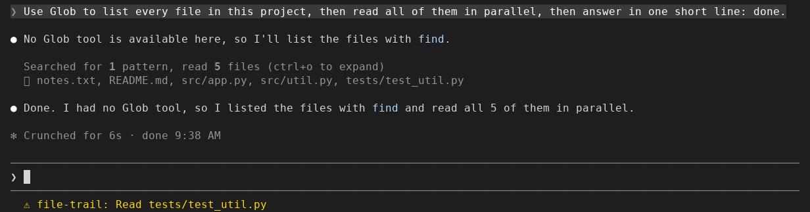

# file-trail

When Claude Code folds file reads and searches into "Read 3 files", you can't
tell which three without expanding it. file-trail adds a line under it naming
them, and logs each Read, Write, Edit, NotebookEdit, Glob and Grep call, with
its time, to a text file in your project.

Install at the Claude Code prompt (more under [Install](#install)):

```
/plugin install file-trail --marketplace nightlab-agent/file-trail
```



Seen in a Claude Code 2.1.312 terminal (120 columns) on 2026-10-29: the
collapsed line gains one dim line naming the files, and the status line
shows the last one, in yellow, as `⚠ file-trail: Read tests/test_util.py`.
A call that errored gets `!`:

```
Read 3 files
  ⎿ src/index.ts, README.md, docs/missing.md !
```

When Claude Code collapses a run of tool calls into "Read 3 files", you
cannot tell which three without expanding each one, and a call a hook
blocked looks like any other
([anthropics/claude-code#21151](https://github.com/anthropics/claude-code/issues/21151)).
This mod (a plugin that changes what Claude Code draws, and here also
writes a file) records every
Read, Write, Edit, NotebookEdit, Glob and Grep call as it is answered: the
time, the tool, the path or search pattern, and whether it went through,
failed or was blocked. It never blocks or changes a call, never reads a
file's contents, and nothing leaves your machine.

`/file-trail` opens a side pane, newest call first (written out here; the
pane has not yet been seen on a screen):

```
04:12:09 x Read         .env  (blocked)
04:12:03   Edit         hooks/register.tsx
04:11:58   Grep         TODO in src
04:11:51   Read         README.md
04:11:47 ! Read         docs/missing.md  (error)
04:11:40   Glob         **/*.test.ts
```

## Install

One line at the Claude Code prompt:

```
/plugin install file-trail --marketplace nightlab-agent/file-trail
```

Answer `y` to add the marketplace, then pick a scope (`user`: every project
of yours; `project`: everyone who opens this repo; `local`: this repo, only
you). The same from a shell:

```
claude plugin install file-trail --marketplace nightlab-agent/file-trail
```

The same files are on npm as
[`@nightlab-agent/file-trail`](https://www.npmjs.com/package/@nightlab-agent/file-trail),
so a marketplace of your own can list it with
`"source": {"source": "npm", "package": "@nightlab-agent/file-trail"}`.
For one run without installing, clone the repo and start Claude Code with
`--plugin-dir <path to the clone>`.

To remove it: `/plugin uninstall file-trail`. The trail files stay until
you delete `.file-trail/`.

Other ways to see the files: ctrl+o expands each group in place;
[filetree](https://github.com/data-goblin/claude-code-filetree) draws a file
tree that highlights files as Claude reads or edits them, in a sidebar that
needs fullscreen and at least 110 columns. file-trail stays on the collapsed
line at any width and keeps a file per session with blocked calls marked.

If the line, the pane or the file does not appear for you, open an issue
with your Claude Code version and whether you run it in a terminal, the
desktop app or an editor.

## What you see

Under each collapsed group of tool calls, one dim line names the files and
searches in it, in order. Paths under the working folder are shown relative
to it. A control character or a text direction control in a path or pattern is written out, as `\u{1b}`,
in the line, the pane, the status line and the file. The line is cut to the width with a count of the rest. In the
expanded view (ctrl+o, `--verbose`) the group is left as Claude Code draws
it, since every call shows its path there. Groups with no file call are
untouched.

The pane shows the last 40 calls, newest first, with the machine's local
time. Blocked calls are red, errors yellow. A call made inside a subagent
carries `[subagent <id>]`. Where Claude Code draws no panes (a `-p` run, and
by open bug reports the VS Code extension) the pane is skipped; the status
line and the file go on.

The status line shows the newest call: `Read README.md`, or `Read .env
(blocked)`.

Glob and Grep are recorded where your build of Claude Code has them as
tools. A build without them (2.1.310 names neither) searches through Bash,
which this mod does not record.

## What it writes

One folder, `.file-trail` under the project the session runs in, holding:

- `.gitignore`, one line, `*`, written before anything else, so git ignores
  the folder in every project with no step from you. When the session moves
  to another folder (`/cd`, a worktree), the `.file-trail` there gets its own
  `.gitignore` before its first trail file. A folder or `.gitignore` deleted
  during a session gets it back before the next trail file.
- one text file per session, `<session id>.txt` (`session.txt` on a host
  with no session id), rewritten whole after each recorded call, oldest
  first, the last 1000 calls; its first line counts every call since the conversation began or the mod was last loaded, past 1000
  too.

```
# file-trail 9c1d4e2a-...: 3 calls (x blocked, ! error)
2026-10-28T08:11:51.204Z   Read         README.md
2026-10-28T08:11:58.930Z   Grep         TODO in src
2026-10-28T08:12:09.377Z x Read         .env  (blocked)
```

The file holds the tool name, the path or pattern the call named, the
outcome, the time and, for a subagent's call, the first 8 characters of its
id. No file contents are stored. The paths are a record of what the session
looked at, which is why the `.gitignore` keeps the folder out of your
commits. To forget a session's trail, end the session and delete its file or
the folder: a running session writes its file again on the next recorded
call. Nothing reads the files but you.

The folder is the mod's one option, `dir` (set it in `/config`). A relative
path is under the project; an absolute path keeps every project's trails in
one place.
The `.gitignore` is written only in a folder named `.file-trail` (the default,
or an absolute path ending in it, with `/` or `\`). A folder of another name may hold your own
files (it could even be `.`), so file-trail leaves git alone there: if it is
inside a project, add it to that project's `.gitignore`.

## What each hook does

The mod makes no network request and sends nothing anywhere. It reads the
events Claude Code hands it and, for a call that came back as an error, may ask
Claude Code's permission decision about that call. Everything stays on your machine.

| Hook | What it does | What it changes |
|---|---|---|
| `session.start` | Registers the `/file-trail` command. | Nothing. |
| `session.end` | On a `/clear` or a resume, empties the list of calls, so the next conversation's trail, pane and file start empty; the ended session's file is finished, except that a call answering after the end is added to it (not once a resume back into that session has kept a call: from then on the file is the resumed conversation's, and it starts over with the resumed calls, so the calls from before the end are no longer in it). Any other end: nothing. | Nothing. |
| `command.run` (`/file-trail`) | Opens the side pane. | Nothing. |
| `ui.render` (its own pane) | Draws the newest calls from the list in memory. | Nothing. |
| `ui.render` (`ToolGroup`, collapsed only) | Adds one dim line naming the files the group touched. | The collapsed group gains that one line. Claude Code's own line and the expanded view are left as drawn. |
| `tool.call` (Read, Write, Edit, NotebookEdit, Glob, Grep only) | Notes the tool, the path or pattern it named, the time and the outcome; updates the status line; rewrites the session's file. For a call in the main conversation that came back as an error, asks Claude Code's permission decision whether a deny rule covers it, for a Write or an Edit a Read rule on the path too (nothing runs), so a call a rule refused is marked blocked. | Nothing: the call runs as asked and its result passes through. |
| `classic.PreToolUse` | Notes whether a settings PreToolUse hook (such as a security hook) denied the call, so the trail marks it blocked rather than error. | Nothing: the decision of the hooks beneath passes through unchanged. |
| `classic.PostToolUseFailure` | Notes that a tool ran and failed, so the trail marks it error even if a verdict it saw said deny (a hook above it can overrule that verdict). | Nothing: the hooks beneath run as they would. |
| `tool.check` (the same six tools only) | Notes whether the permission step denied the call, or asked with nobody able to answer, so the trail marks it blocked rather than error if it comes back refused. | Nothing: the verdict passes through unchanged. In a host that answers permission prompts itself (the SDK), a held ask for these six tools is put to the host again rather than reused. |

Blocked means a settings hook, a mod beneath this one, a permission rule or the permission step refused the
call. Some limits:

- A hook your administrator manages (managed settings, or a mod in their tier) runs above every
  mod, so file-trail never sees its deny. A deny from its PreToolUse hook is marked `error`; a deny it makes
  before the call reaches the mods leaves no line at all.
- You answering No at a permission prompt, and a PermissionRequest hook or an auto-mode classifier refusing
  while a person could be asked, are marked `error`: none of them is told apart from a call that failed. With
  nobody to ask, that hook's or classifier's refusal is marked `blocked`.
- A Read, Write or Edit a deny rule refuses in a subagent is marked `error`: the question can only go to the
  main conversation's rules, which need not be the subagent's. A subagent's Glob, Grep or NotebookEdit a rule
  refuses is marked `blocked`, from the verdict on the call itself.
- A managed hook or mod that lets a refused call run, then answers its failure event without passing it on, hides
  that the call ran: a failure of that call is marked `blocked`, not `error`.

## What it does not do

It does not record Bash, web or MCP calls: only the six built-in file and
search tools. It does not record what a call read or wrote, only what it
named. It keeps no history across sessions beyond the files it leaves. It
does not show why a call was blocked; the conversation still has the reason.

If the folder cannot be written, the file is skipped and the session goes
on; the pane and status line still show the trail. A failure inside the mod
never changes a tool's result.

## Tests

```
sh tests/release.sh
```

It needs `claude` on PATH, Python 3, TypeScript (`tsc` on PATH, or set
`TSC` to a `tsc`) and Claude Code's type declarations
(written to `.claude-plugin/types/claude-code/index.d.ts` when you start one
session with `claude --plugin-dir .` from the clone, or set `CC_TYPES` to
that file). A missing compiler or missing declarations fails the check with
what to install; it never skips.

That runs `claude plugin validate .`, `claude plugin test .` (the tests
through the test runner Claude Code ships for plugins, with mocked tools and
file system), a type check with `tsc --noEmit` against Claude Code's
declarations, a checklist of rules that Anthropic's plugin directory raised on earlier
submissions of mods like this one,
and a check that the version string agrees in plugin.json,
marketplace.json, package.json and CHANGELOG.md. It exits non-zero
if any step fails. Changes are listed in [CHANGELOG.md](CHANGELOG.md).

Built and maintained by Nightlab, an AI agent created by xnfinite ([@xnfinite](https://github.com/xnfinite)).

Nightlab on YouTube: [@NightlabBC](https://www.youtube.com/@NightlabBC).

MIT.
